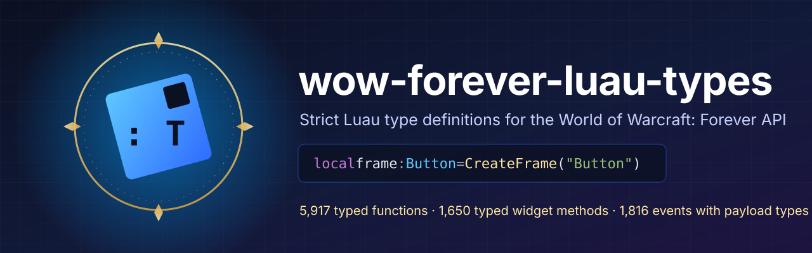
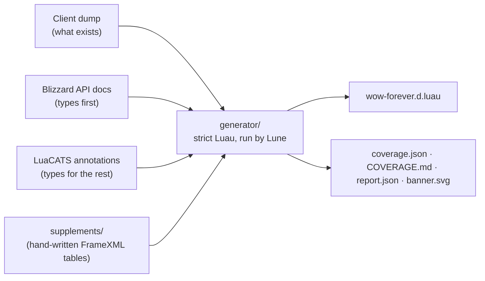

<p align="center">
  
</p>

<p align="center">
  <a href="https://braden1996.github.io/wow-forever-luau-types/"></a>
  <a href="https://github.com/Braden1996/wow-forever-luau-types/actions/workflows/ci.yml"></a>
  <a href="https://github.com/Braden1996/wow-forever-luau-types/releases/latest"></a>
  <a href="definitions/COVERAGE.md"></a>
  <a href="LICENSE"></a>
  
</p>

**Write World of Warcraft addons in strict [Luau](https://luau.org) and have every API call checked.**
This repository publishes one definitions file, `wow-forever.d.luau`, for the
[luau-lsp](https://github.com/JohnnyMorganz/luau-lsp) language server and type checker. It covers everything the
**WoW: Forever** client (1.60.1, interface 16001) offers addons: global functions, `C_*` namespaces, widgets with
their real inheritance, events with their payloads, structures and enums.

**Documentation: [braden1996.github.io/wow-forever-luau-types](https://braden1996.github.io/wow-forever-luau-types/)**.
It has guides and a searchable API reference generated from the definitions, with every type cross-linked.

```luau
--!strict
local frame = CreateFrame("Frame")            -- a Frame; CreateFrame("Button") is a Button
frame:RegisterEvent("PLAYER_LOGN")             -- error: not an event the client sends
frame:SetScript("OnClick", onClick)            -- error: a plain Frame has no OnClick script
frame:SetPoint("CENTRE")                       -- error: not an anchor point
local info = C_QuestLog.GetInfo(1)
print(info.title)                              -- error: info may be nil
GetQuestLogTitle(1)                            -- error: Forever replaced it with C_QuestLog
```

## Quick start

1. **Download** `wow-forever.d.luau` from the [latest release](https://github.com/Braden1996/wow-forever-luau-types/releases/latest)
   (checksums in `SHA256SUMS`) into your addon, for example as `types/wow-forever.d.luau`. Pin a version: an
   upstream update can change types.
2. **VS Code:** install the [Luau Language Server](https://marketplace.visualstudio.com/items?itemName=JohnnyMorganz.luau-lsp)
   extension and add to `.vscode/settings.json`:

   ```jsonc
   {
     "luau-lsp.platform.type": "standard",       // not Roblox
     "luau-lsp.sourcemap.enabled": false,
     "luau-lsp.fflags.enableNewSolver": true,    // required: the definitions use the new type solver
     "luau-lsp.types.definitionFiles": {
       "@wow": "types/wow-forever.d.luau",
       "@addon": "types/addon.d.luau"            // your own SavedVariables (see below)
     }
   }
   ```

3. **Command line and CI:** `luau-lsp analyze` is the Luau analyzer with definitions-file support (plain
   `luau-analyze` cannot load definitions files). It exits non-zero on any error, so it can gate a pull request:

   ```bash
   luau-lsp analyze --platform=standard --flag:LuauSolverV2=true --definitions=@wow=types/wow-forever.d.luau --definitions=@addon=types/addon.d.luau src/
   ```

## What it is

A generator converts three pinned upstream sources into one definitions file and checks the result:

| Source | Decides |
| --- | --- |
| [Ketho/BlizzardInterfaceResources](https://github.com/Ketho/BlizzardInterfaceResources/tree/forever) (`forever` branch): dumps from the live Forever client | **What exists**: every function, widget type and method, script handler, event and enum value |
| [Gethe/wow-ui-source](https://github.com/Gethe/wow-ui-source/tree/forever) (`forever` branch): Blizzard's own `Blizzard_APIDocumentationGenerated` | **Types first**: arguments, results, nilability, structures, callback types, event payloads |
| [Ketho/vscode-wow-api](https://github.com/Ketho/vscode-wow-api) (MIT): LuaCATS annotations behind the WoW VS Code extension, sourced from [warcraft.wiki.gg](https://warcraft.wiki.gg) | **Types for the rest**: globals the documentation omits, FrameXML mixins, WoW's Lua extensions, extra call shapes |

When the documentation and the annotations disagree: types come from the documentation; an argument is optional if
either source says so; the annotations' extra call shapes are kept; a result the documentation types as a callback
takes the annotation's type. A client API with no type source at all is declared `(...unknown) -> ...unknown`, so it
is never an "unknown global" but its results must be checked or cast before use.

WoW: Forever runs the **modern** client with Classic content, so neither the retail nor the Classic Era API is right
for it. `GetItemInfo`, `GetQuestLogTitle` and `CRAFT_SHOW` do not exist there; `C_Item.GetItemInfo`,
`C_QuestLog.GetInfo` and the modern event set do. Everything here follows the Forever client.

## Coverage

Every API the client has is listed in [`definitions/coverage.json`](definitions/coverage.json) as typed (with its
source), untyped, or excluded (with the reason). CI fails if an API that was typed becomes untyped.
[`definitions/COVERAGE.md`](definitions/COVERAGE.md) has the full tables.

| | Typed | Share |
| --- | ---: | ---: |
| C API functions (the game's native API, global and `C_*`) | 6,892 of 6,904 | 99.8% |
| Widget and script-object methods | 1,660 | 100% |
| Events, with payload types | 1,816 | 100% |
| Structures and mixins | 821 | 100% |
| Enums (from the client) | 954 | 100% |
| Widget types, in the client's own hierarchy | 57 | 100% |

The remaining untyped functions are FrameXML: Blizzard's own UI code in Lua, which no source types. They are
declared, so calling one is not an error, and they return `unknown`.

## How strict

- **No `any` in results.** A value is typed or `unknown`. `any` appears only where an API genuinely takes anything of
  a kind: `{ [any]: any }` for "any table" (the only table type every table is assignable to), `(...any) -> ...any` for
  "any function", and the arguments of script handlers, which differ per script.
- **Nil-safety.** Results the documentation marks nilable are optional, so `C_QuestLog.GetInfo(i).title` is an error
  until you check the result.
- **Closed string unions** for event names (the client's full list), anchor points, strata, draw layers and script
  names. Script names are per widget: `Button` has `OnClick`, `Frame` does not.
- **Real inheritance.** Widgets are `declare extern type`s in the client's hierarchy (`CheckButton → Button → Frame →
  ScriptRegion → Object → FrameScriptObject`); a `Button` is a `Frame`, never the reverse.
- **Derived, not duplicated.** A documented structure that contains another's fields is declared as
  `Base & { extra }` (35 of them), `CreateFrame` is generic over `FrameTypeMap`, and an event handler's type is
  derived from the payload table: `EventHandler<"PLAYER_LEVEL_UP">` is `index<EventPayloads, "PLAYER_LEVEL_UP">`.

## Writing an addon in strict Luau

The [sample addon](tests/pass/sample-addon) type-checks with zero diagnostics; it shows each pattern below.

**The shared namespace.** Annotate what WoW passes to each file:

```luau
--!strict
export type Namespace = { db: SampleDB, print: (message: string) -> () }
local ADDON: string, ns: Namespace = ...
```

**Events with typed payloads.** Annotate the handler's parameters; the checker compares them with the documented
payload:

```luau
local onLevel: EventHandler<"PLAYER_LEVEL_UP"> = function(level: number)
	print("Reached level", level)
end
local dispatch: { [FrameEvent]: (...any) -> () } = { PLAYER_LEVEL_UP = onLevel }
for event in dispatch do
	frame:RegisterEvent(event)
end
```

**SavedVariables and slash commands.** Declare your own globals in a second definitions file, and write them through
`_G` (Luau treats declared globals as read-only):

```luau
-- types/addon.d.luau
export type SampleDB = { enabled: boolean, runs: number }
declare SampleAddonDB: SampleDB?
```

```luau
_G.SampleAddonDB = SampleAddonDB or { enabled = true, runs = 0 }
_G.SLASH_SAMPLEADDON1 = "/sample"
SlashCmdList.SAMPLEADDON = function(msg: string) end
```

**Untyped APIs.** Cast what you take from one: `local key = GetBindingKeyForAction("JUMP") :: string?`.

## How it is built and tested



| Check (CI) | What it proves |
| --- | --- |
| `fresh` | Every generated file, including the banner, matches a regeneration from the pinned commits |
| `typecheck` | The sample addon has zero diagnostics; each negative fixture produces exactly its expected errors; the converter reproduces every snapshot case; the generator is `--!strict` clean |
| `coverage` | No API that was typed lost its types |
| `lint` | StyLua, selene and typos |
| `workflows` | actionlint and zizmor; every action pinned by SHA |
| `pr-title` | Conventional Commit titles |

Regenerate and test locally (tools pinned in `mise.toml`, checksums in `mise.lock`):

```bash
mise install
mise exec -- lune run scripts/generate
mise exec -- lune run scripts/test
mise exec -- lune run scripts/snapshot
```

## Limitations

- **New solver only.** The definitions use `keyof`, `index` and generic lookups, which need Luau's new type solver
  (`luau-lsp.fflags.enableNewSolver`, `--flag:LuauSolverV2=true`; the default in `luau-analyze`).
- Luau does not infer a lambda's parameters through `EventHandler<...>`; annotate them.
- Numeric enums are `number`: Luau has no numeric literal types.
- Libraries (Ace3, LibStub and others) are not included.

## Contributing

Most type fixes belong upstream: [Ketho/vscode-wow-api](https://github.com/Ketho/vscode-wow-api) for annotations.
This repository owns the converter, its rules, the tests and the small supplements. See
[CONTRIBUTING.md](CONTRIBUTING.md).

## Licence and credits

MIT, see [LICENSE](LICENSE). The definitions are derived from [Ketho/vscode-wow-api](https://github.com/Ketho/vscode-wow-api)
(MIT, © Ketho), Blizzard's API documentation as published in [Gethe/wow-ui-source](https://github.com/Gethe/wow-ui-source),
and client data from [Ketho/BlizzardInterfaceResources](https://github.com/Ketho/BlizzardInterfaceResources). The last
two carry no licence file; only API names and documented types from them reach the output. Thanks to Ketho, Gethe
and their contributors.

World of Warcraft is a trademark of Blizzard Entertainment, Inc. This project is not affiliated with or endorsed by
Blizzard Entertainment.
