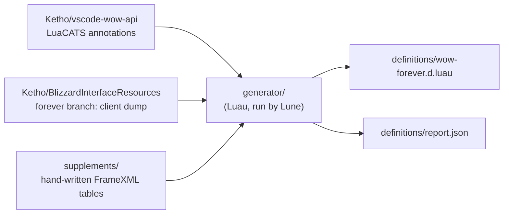

<p align="center">
  
</p>

<p align="center">
  <a href="https://github.com/Braden1996/wow-forever-luau-types/actions/workflows/ci.yml"></a>
  <a href="https://github.com/Braden1996/wow-forever-luau-types/releases/latest"></a>
  <a href="LICENSE"></a>
  
</p>

Write World of Warcraft addons in **strict [Luau](https://luau.org)** and have every API call checked. This repository
publishes one definitions file, `wow-forever.d.luau`, for [luau-lsp](https://github.com/JohnnyMorganz/luau-lsp): the
globals, `C_*` namespaces, widgets with their inheritance, enums and event names of the **WoW: Forever** client
(`WOW_PROJECT_CAMELOT`, interface 16001).

```luau
--!strict
local frame = CreateFrame("Frame")
frame:RegisterEvent("PLAYER_LOGN")        -- TypeError: '"PLAYER_LOGN"' is not a FrameEvent
frame:SetPoint("CENTRE")                  -- TypeError: '"CENTRE"' is not a FramePoint
frame:SetText("hello")                    -- TypeError: Key 'SetText' not found in external type 'Frame'
local name: number = UnitName("player")   -- TypeError: Expected 'number', got 'string'
GetQuestLogTitle(1)                       -- TypeError: Unknown global (Forever uses C_QuestLog)
```

## Why this exists

- **No WoW typings for Luau existed.** WoW addon tooling targets LuaLS annotations; Luau's type checker cannot read
  them.
- **Converted, not hand-written.** A generator turns [Ketho/vscode-wow-api](https://github.com/Ketho/vscode-wow-api)'s
  LuaCATS annotations (the types behind the popular VS Code extension) into Luau declarations.
- **Exactly what the Forever client has.** WoW: Forever runs a modern client with Classic content, so neither the
  retail nor the Classic Era API is right. The output is filtered against
  [Ketho/BlizzardInterfaceResources](https://github.com/Ketho/BlizzardInterfaceResources/tree/forever)'s dump of the live
  Forever client: an API the client lacks is dropped, and a client API with no annotation is still declared (untyped),
  so a real API is never an "unknown global".
- **Reproducible.** Both inputs are pinned by commit in [`upstream.toml`](upstream.toml). CI regenerates the file
  from those commits and fails if the committed copy differs.

| In `wow-forever.d.luau`                                             | Count |
| ------------------------------------------------------------------- | ----: |
| Typed functions (global and namespaced)                             | 6,610 |
| Client C API functions that are typed                               |   94% |
| Widget types (`declare extern type`, with inheritance)              |   152 |
| Structures and mixins (table types)                                 |   764 |
| `Enum.*` tables (from the client) and enum value types              |   954 |
| Annotated retail APIs dropped because the Forever client lacks them |   266 |

[`definitions/report.json`](definitions/report.json) lists every number above, plus each dropped API, each untyped
API and every annotation type name that could not be resolved.

## Install

Download `wow-forever.d.luau` from the [latest release](https://github.com/Braden1996/wow-forever-luau-types/releases/latest)
(a `SHA256SUMS` file is attached), or vendor this repository at a tag. Pin a version: a new upstream commit can
change the types.

```bash
curl -fsSLO https://github.com/Braden1996/wow-forever-luau-types/releases/download/v0.1.0/wow-forever.d.luau
```

## Use it with luau-lsp

### VS Code

Install the [Luau Language Server](https://marketplace.visualstudio.com/items?itemName=JohnnyMorganz.luau-lsp)
extension, then in `.vscode/settings.json`:

```jsonc
{
  "luau-lsp.platform.type": "standard", // not Roblox
  "luau-lsp.sourcemap.enabled": false,
  "luau-lsp.types.definitionFiles": {
    "@wow": "types/wow-forever.d.luau",
    "@addon": "types/addon.d.luau" // your SavedVariables; see below
  }
}
```

### Command line and CI

`luau-lsp analyze` is `luau-analyze` with support for definitions files (plain `luau-analyze` cannot load them):

```bash
luau-lsp analyze --platform=standard --definitions=@wow=types/wow-forever.d.luau --definitions=@addon=types/addon.d.luau src/
```

It exits non-zero on any type error or lint, so it can gate a pull request as-is.

## Writing an addon in strict Luau

The [sample addon](tests/pass/sample-addon) type-checks with zero diagnostics under `--!strict`; it is the reference
for the patterns below.

**The shared namespace.** Annotate what WoW passes to each file:

```luau
--!strict
export type Namespace = { db: SampleDB, print: (message: string) -> () }
local ADDON: string, ns: Namespace = ...
```

**SavedVariables and slash commands.** Declare your own globals in a second definitions file, and write them through
`_G` (Luau treats declared globals as read-only):

```luau
-- types/addon.d.luau
export type SampleDB = { enabled: boolean, runs: number }
declare SampleAddonDB: SampleDB?
```

```luau
_G.SampleAddonDB = SampleAddonDB or { enabled = true, runs = 0 }
_G.SLASH_SAMPLEADDON1 = "/sample"
SlashCmdList.SAMPLEADDON = function(msg: string) end
```

**Closed string unions.** Event names (`FrameEvent`, the client's full list), anchor points, strata, draw layers,
frame types and script handler names are unions of string literals, so a typo is a type error. `CreateFrame("Button")`
returns a `Button`.

**Untyped APIs.** A client function with no upstream annotation is declared `(...any) -> ...any`. Annotate what you
take from it (`local key: string? = GetBindingKeyForAction(action)`), and consider typing it upstream.

## How it is built



1. `generator/parse.luau` reads each annotation file: `---@class`, `---@field`, `---@param`, `---@return`, `---@alias`,
   `---@enum`, `---@overload` and `---@generic`.
2. `generator/typeexpr.luau` parses LuaCATS type expressions (`fun(...)`, `T[]`, `table<K, V>`, unions, literals) and
   prints Luau types.
3. `generator/build.luau` decides the shape: widget classes become `declare extern type` with `extends`; other classes
   become table types; `C_*` tables and `Enum` become declared globals. It keeps only what the client has.
4. A few Luau constraints shape the output: overloads that return the same thing are merged so string literals still
   infer (`SetPoint("CENTER")`); `CreateFrame` gets one overload per frame type; very long unions are declared in
   chunks.

Regenerate with:

```bash
mise install
mise exec -- lune run scripts/generate
mise exec -- lune run scripts/test
```

## Limitations

- Upstream annotations follow the retail client. Where Forever's signature differs from retail's, the retail one
  wins until someone fixes it upstream.
- Optional-looking parameters follow LuaCATS: `x?` means "may be nil", not "may be omitted before a later argument".
- Events have names but not payload types yet: an `OnEvent` handler receives `...: any`.
- Libraries (Ace3, LibStub and others) are not included.

## Contributing

Most fixes belong upstream: types in [Ketho/vscode-wow-api](https://github.com/Ketho/vscode-wow-api), client data in
[Ketho/BlizzardInterfaceResources](https://github.com/Ketho/BlizzardInterfaceResources). This repository owns the
converter, the samples and the small supplements. See [CONTRIBUTING.md](CONTRIBUTING.md).

## Licence and credits

MIT, see [LICENSE](LICENSE). The definitions are derived from
[Ketho/vscode-wow-api](https://github.com/Ketho/vscode-wow-api) (MIT, © Ketho) and filtered with data from
[Ketho/BlizzardInterfaceResources](https://github.com/Ketho/BlizzardInterfaceResources). Thanks to Ketho and that
project's contributors, whose work makes this one possible.

World of Warcraft is a trademark of Blizzard Entertainment, Inc. This project is not affiliated with or endorsed by
Blizzard Entertainment.
