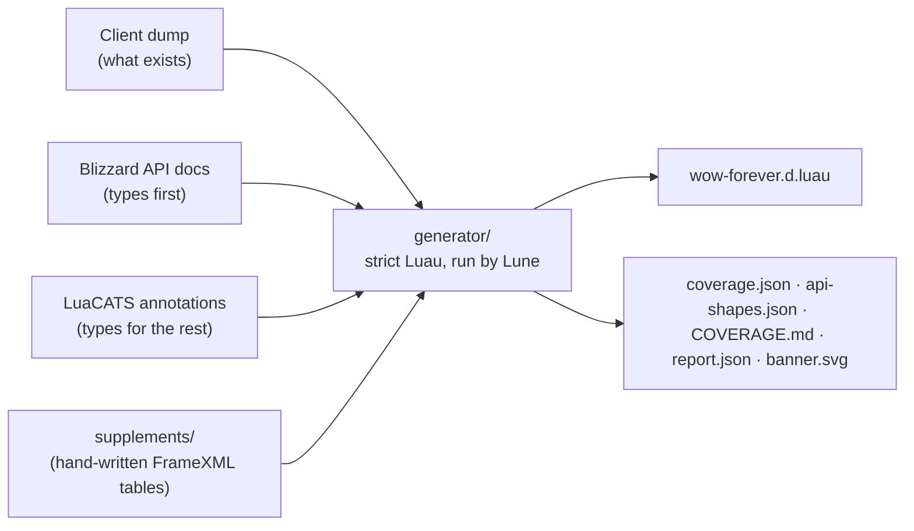

<p align="center">
  
</p>

<p align="center">
  <a href="https://braden1996.github.io/wow-forever-luau-types/"></a>
  <a href="https://github.com/Braden1996/wow-forever-luau-types/actions/workflows/ci.yml"></a>
  <a href="https://github.com/Braden1996/wow-forever-luau-types/releases/latest"></a>
  <a href="definitions/COVERAGE.md"></a>
  <a href="LICENSE"></a>
  
</p>

**Write World of Warcraft addons in strict [Luau](https://luau.org) and have every API call checked.**
This repository publishes one definitions file, `wow-forever.d.luau`, for the
[luau-lsp](https://github.com/JohnnyMorganz/luau-lsp) language server and type checker. It covers everything the
**WoW: Forever** client (1.60.1, interface 16001) offers addons: global functions, `C_*` namespaces, widgets with
their real inheritance, events with their payloads, structures and enums.

**Documentation: [braden1996.github.io/wow-forever-luau-types](https://braden1996.github.io/wow-forever-luau-types/)**.
It has guides and a searchable API reference generated from the definitions, with every type cross-linked.

```luau
--!strict
local frame = CreateFrame("Frame")            -- a Frame; CreateFrame("Button") is a Button
frame:RegisterEvent("PLAYER_LOGN")             -- error: not an event the client sends
frame:SetScript("OnClick", onClick)            -- error: a plain Frame has no OnClick script
frame:SetPoint("CENTRE")                       -- error: not an anchor point
local info = C_QuestLog.GetInfo(1)
print(info.title)                              -- error: info may be nil
GetQuestLogTitle(1)                            -- error: Forever replaced it with C_QuestLog
```

## Quick start

**Fastest:** copy the [addon template](templates/addon). It has the editor settings (VS Code and Zed), a pinned type
checker and Luau-to-Lua-5.1 build (mise, luau-lsp, darklua), a typed shared namespace, SavedVariables and typed event
handlers. CI type-checks and builds it on every change here.

**By hand:**

1. **Download** `wow-forever.d.luau` from the [latest release](https://github.com/Braden1996/wow-forever-luau-types/releases/latest)
   (checksums in `SHA256SUMS`) into your addon, for example as `types/wow-forever.d.luau`. Pin a version: an
   upstream update can change types.
2. **VS Code:** install the [Luau Language Server](https://marketplace.visualstudio.com/items?itemName=JohnnyMorganz.luau-lsp)
   extension and add to `.vscode/settings.json`:

   ```jsonc
   {
     "luau-lsp.platform.type": "standard", // not Roblox
     "luau-lsp.sourcemap.enabled": false,
     "luau-lsp.fflags.enableNewSolver": true, // required: the definitions use the new type solver
     "luau-lsp.types.definitionFiles": {
       "@wow": "types/wow-forever.d.luau",
       "@addon": "types/addon.d.luau" // your own SavedVariables (see below)
     }
   }
   ```

3. **Command line and CI:** `luau-lsp analyze` is the Luau analyzer with definitions-file support (plain
   `luau-analyze` cannot load definitions files). It exits non-zero on any error, so it can gate a pull request:

   ```bash
   luau-lsp analyze --platform=standard --flag:LuauSolverV2=true --definitions=@wow=types/wow-forever.d.luau --definitions=@addon=types/addon.d.luau src/
   ```

## What it is

A generator converts three pinned upstream sources into one definitions file and checks the result:

| Source                                                                                                                                                                                 | Decides                                                                                                           |
| -------------------------------------------------------------------------------------------------------------------------------------------------------------------------------------- | ----------------------------------------------------------------------------------------------------------------- |
| [Ketho/BlizzardInterfaceResources](https://github.com/Ketho/BlizzardInterfaceResources/tree/forever) (`forever` branch): dumps from the live Forever client                            | **What exists**: every function, widget type and method, script handler, event and enum value                     |
| [Gethe/wow-ui-source](https://github.com/Gethe/wow-ui-source/tree/forever) (`forever` branch): Blizzard's own `Blizzard_APIDocumentationGenerated`                                     | **Types first**: arguments, results, nilability, structures, callback types, event payloads                       |
| [Ketho/vscode-wow-api](https://github.com/Ketho/vscode-wow-api) (MIT): LuaCATS annotations behind the WoW VS Code extension, sourced from [warcraft.wiki.gg](https://warcraft.wiki.gg) | **Types for the rest**: globals the documentation omits, FrameXML mixins, WoW's Lua extensions, extra call shapes |

When the documentation and the annotations disagree: types come from the documentation; an argument is optional if
either source says so; the annotations' extra call shapes are kept; a result the documentation types as a callback
takes the annotation's type. A client API with no type source at all is declared `(...unknown) -> ...unknown`, so it
is never an "unknown global" but its results must be checked or cast before use.

WoW: Forever runs the **modern** client with Classic content, so neither the retail nor the Classic Era API is right
for it. `GetItemInfo`, `GetQuestLogTitle` and `CRAFT_SHOW` do not exist there; `C_Item.GetItemInfo`,
`C_QuestLog.GetInfo` and the modern event set do. Everything here follows the Forever client.

## Coverage

Every API the client has is listed in [`definitions/coverage.json`](definitions/coverage.json) as typed (with its
source), untyped, or excluded (with the reason). CI fails if an API that was typed becomes untyped.
[`definitions/COVERAGE.md`](definitions/COVERAGE.md) has the full tables.

[`definitions/api-shapes.json`](definitions/api-shapes.json) gives every function and widget method a result shape for
libraries that wrap the API: `maybe` (one nilable result), `record` (several results, each with its documented name
and nilability), `value`, `void` or `variadic`; `protected` for what Blizzard flags `IsProtectedFunction`, which must
never be wrapped. It also records whether the call may return nothing at all (`absent`, from `MayReturnNothing` or a
precondition that fails by returning nothing; the definitions type every result of such a call as optional), which
parameters take a callback, and whether the first of several
results is a boolean. It states facts only: whether a boolean means success, or a nil means "not cached yet", is the
wrapping library's decision.

|                                                           |          Typed | Share |
| --------------------------------------------------------- | -------------: | ----: |
| C API functions (the game's native API, global and `C_*`) | 5,757 of 6,904 | 83.4% |
| Widget and script-object methods                          | 1,720 of 1,733 | 99.2% |
| Events, with payload types                                |          1,816 |  100% |
| Structures and mixins                                     |            840 |  100% |
| Enums (from the client)                                   |            954 |  100% |
| Widget types, in the client's own hierarchy               |             58 |  100% |

Most untyped functions (5,691) are FrameXML: Blizzard's own UI code in Lua, which no source types. 1,147 C API
functions are untyped too: 1,135 of them the annotations list only as wiki stubs without a single type, and 12 have
no source at all; so are 17 Lua-extension functions. They are declared, so calling one is not an error, and they
return `unknown`. A function is counted as typed only when a source gives its types.

## How strict

- **No `any` in results.** A value is typed or `unknown`. `any` appears only where an API genuinely takes anything of
  a kind: `{ [any]: any }` for "any table" (the only table type every table is assignable to), `(...any) -> ...any` for
  "any function", and the arguments of script handlers, which differ per script.
- **Only what WoW has.** Luau standard-library names that WoW's Lua 5.1 lacks (`table.clone`, `table.find`, `typeof`,
  `buffer`, ...) are disabled through [`definitions/luau-lsp.settings.json`](definitions/luau-lsp.settings.json)
  (pass it with `--settings`; the template and the editor configs include it), so code that type-checks also runs.
- **Nil-safety.** Results the documentation marks nilable are optional, so `C_QuestLog.GetInfo(i).title` is an error
  until you check the result.
- **Closed string unions** for event names (the client's full list), anchor points, strata, draw layers and script
  names. Script names are per widget: `Button` has `OnClick`, `Frame` does not.
- **Real inheritance.** Widgets are `declare extern type`s in the client's hierarchy (`CheckButton → Button → Frame →
  ScriptRegion → Object → FrameScriptObject`); a `Button` is a `Frame`, never the reverse.
- **Derived, not duplicated.** The 32 UI widget visualization infos are `UIWidgetVisualizationInfoBase & { extra }`
  (structures that only happen to share fields stay separate), `CreateFrame` is generic over `FrameTypeMap`, and an event handler's type is
  derived from the payload table: `EventHandler<"PLAYER_LEVEL_UP">` is `index<EventPayloads, "PLAYER_LEVEL_UP">`.

## Writing an addon in strict Luau

The [sample addon](tests/pass/sample-addon) type-checks with zero diagnostics; it shows each pattern below.

**The shared namespace.** Annotate what WoW passes to each file:

```luau
--!strict
export type Namespace = { db: SampleDB, print: (message: string) -> () }
local ADDON: string, ns: Namespace = ...
```

**Events with typed payloads.** Annotate the handler's parameters; the checker compares them with the documented
payload:

```luau
local onLevel: EventHandler<"PLAYER_LEVEL_UP"> = function(level: number)
	print("Reached level", level)
end
local dispatch: { [FrameEvent]: (...any) -> () } = { PLAYER_LEVEL_UP = onLevel }
for event in dispatch do
	frame:RegisterEvent(event)
end
```

**SavedVariables and slash commands.** Declare your own globals in a second definitions file, and write them through
`_G` (Luau treats declared globals as read-only):

```luau
-- types/addon.d.luau
export type SampleDB = { enabled: boolean, runs: number }
declare SampleAddonDB: SampleDB?
```

```luau
_G.SampleAddonDB = SampleAddonDB or { enabled = true, runs = 0 }
_G.SLASH_SAMPLEADDON1 = "/sample"
SlashCmdList.SAMPLEADDON = function(msg: string) end
```

**Untyped APIs.** Cast what you take from one: `local key = GetBindingKeyForAction("JUMP") :: string?`.

## How it is built and tested



[moon](https://moonrepo.dev) orchestrates every task and [mise](https://mise.jdx.dev) pins every tool (versions in
`mise.toml`, checksums in `mise.lock`). `moon run :check` is the gate; CI runs it cold on every pull request, and
the pre-push hook runs it for what changed.

| Task                                       | What it proves                                                                                                      |
| ------------------------------------------ | ------------------------------------------------------------------------------------------------------------------- |
| `generator:fresh`                          | Every generated file, including the banner, matches a regeneration from the pinned commits                          |
| `generator:coverage`                       | No API that was typed on the base branch lost its types                                                             |
| `generator:typecheck`, `lint`, `fmt-check` | The generator is `--!strict` clean, selene-clean and StyLua-formatted                                               |
| `tests:samples`                            | The sample addon and the template have zero diagnostics; each negative fixture produces exactly its expected errors |
| `tests:snapshots`                          | The converter reproduces every snapshot case, and each expected file loads in luau-lsp                              |
| `tests:template-build`                     | The template compiles with darklua to valid Lua 5.1 covering every file its `.toc` loads                            |
| `repo:check`                               | typos, actionlint, zizmor, offline link check, dprint formatting                                                    |

CI also checks Conventional Commit pull request titles. Dependabot bumps the SHA-pinned actions; a weekly workflow
moves the upstream pins and opens a pull request with the regenerated files.

```bash
mise install                        # the pinned tools
mise exec -- lefthook install       # git hooks
mise exec -- moon run :check        # everything CI runs
mise exec -- moon run generator:generate
```

## Editors

| Editor  | Using the definitions in an addon                                                            | Working on this repository                                                                        |
| ------- | -------------------------------------------------------------------------------------------- | ------------------------------------------------------------------------------------------------- |
| VS Code | [`templates/addon/.vscode/`](templates/addon/.vscode/settings.json)                          | [`.vscode/`](.vscode/settings.json): settings, recommended extensions, tasks for the moon targets |
| Zed     | [`templates/addon/.zed/`](templates/addon/.zed/settings.json) (install the "Luau" extension) | [`.zed/settings.json`](.zed/settings.json)                                                        |
| Others  | Run `luau-lsp lsp` with: standard platform, new type solver, definitions `@wow` and `@addon` | Same, plus `.editorconfig`                                                                        |

## Limitations

- **New solver only.** The definitions use `keyof`, `index` and generic lookups, which need Luau's new type solver
  (`luau-lsp.fflags.enableNewSolver`, `--flag:LuauSolverV2=true`; the default in `luau-analyze`).
- Luau does not infer a lambda's parameters through `EventHandler<...>`; annotate them.
- Numeric enums are `number`: Luau has no numeric literal types.
- Libraries (Ace3, LibStub and others) are not included.

## Contributing

A wrong type for a documented C API is fixed here, as a converter rule; one for an undocumented global, FrameXML
mixin or Lua extension belongs upstream in [Ketho/vscode-wow-api](https://github.com/Ketho/vscode-wow-api). This
repository owns the converter, its rules, the tests, the template and the small supplements. See
[CONTRIBUTING.md](CONTRIBUTING.md) and [SECURITY.md](SECURITY.md).

## Licence and credits

MIT, see [LICENSE](LICENSE). The definitions are derived from [Ketho/vscode-wow-api](https://github.com/Ketho/vscode-wow-api)
(MIT, © Ketho), Blizzard's API documentation as published in [Gethe/wow-ui-source](https://github.com/Gethe/wow-ui-source),
and client data from [Ketho/BlizzardInterfaceResources](https://github.com/Ketho/BlizzardInterfaceResources). The last
two carry no licence file; only API names and documented types from them reach the output. Thanks to Ketho, Gethe
and their contributors.

World of Warcraft is a trademark of Blizzard Entertainment, Inc. This project is not affiliated with or endorsed by
Blizzard Entertainment.
